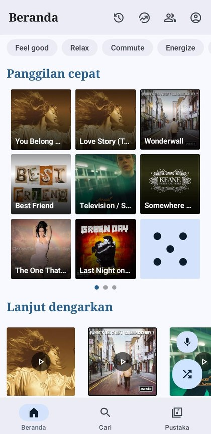
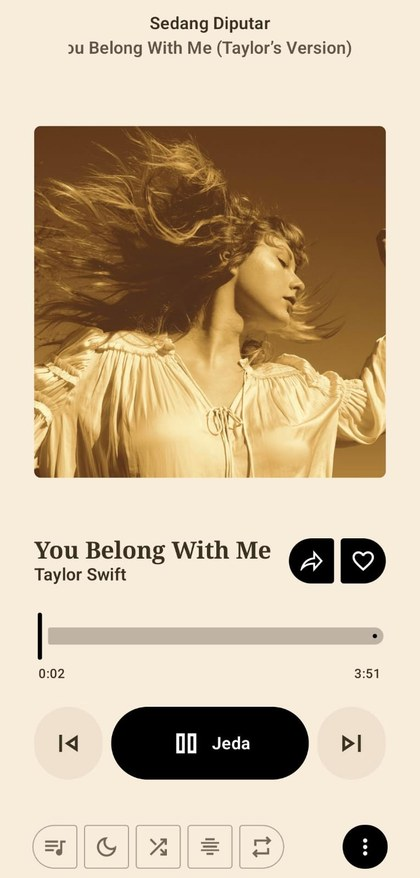
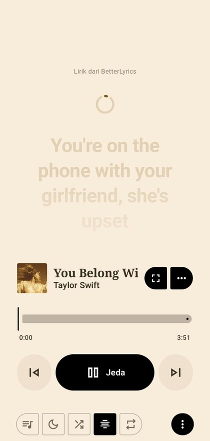
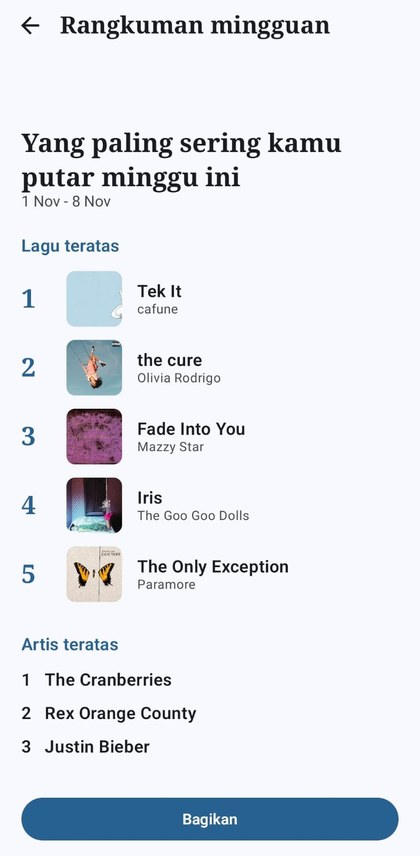

<div align="center">

# Nacitone

**Pemutar musik Android bergaya Nusantara: cepat, hemat kuota, dan terbuka.**

[](https://github.com/NASHKITWO/Nacitone/releases/latest)
[](LICENSE)
[](https://sociabuzz.com/nacitwo/tribe)

[Situs web](https://nacitone.xo.je) · [Unduh](https://github.com/NASHKITWO/Nacitone/releases/latest) · [Kebijakan privasi](PRIVACY.md) · [Laporkan masalah](https://github.com/NASHKITWO/Nacitone/issues)

</div>

---

## Fitur

- **Tanpa akun.** Tidak perlu login. Pustaka, playlist, dan riwayat tersimpan di perangkat Anda.
- **Hemat kuota.** Kualitas otomatis lebih rendah di jaringan seluler, plus penunjuk pemakaian data per sesi.
- **Lirik tersinkron** dan kartu lirik untuk Story Instagram.
- **Rekap Mingguan** bergaya "Wrapped" yang bisa dibagikan sebagai gambar.
- **Tema Nusantara** dan warna dinamis dari sampul lagu.
- **Berbagi playlist lewat QR**, widget layar utama, pengatur waktu tidur, dan alarm musik.
- **Listen Together** untuk mendengarkan bersama teman.
- **Pembaruan otomatis** dari GitHub Releases.
- **Laporkan masalah** langsung dari Tentang: info perangkat dan crash terakhir dilampirkan (tidak ada yang terkirim otomatis).

## Tampilan

<div align="center">

| Beranda | Pemutar | Lirik | Rekap mingguan |
| :---: | :---: | :---: | :---: |
|  |  |  |  |

</div>

## Pasang

1. Buka halaman [Releases](https://github.com/NASHKITWO/Nacitone/releases/latest).
2. Unduh `app-universal-release.apk` (atau sesuai arsitektur perangkat Anda).
3. Izinkan pemasangan dari sumber ini, lalu buka berkas APK.

## Bangun sendiri

```bash
./gradlew :app:assembleFossDebug
```

APK debug: `app/build/outputs/apk/universalFoss/debug/app-universal-foss-debug.apk`

Untuk rilis bertanda tangan, lihat [PANDUAN_RILIS.md](PANDUAN_RILIS.md).

## Privasi dan keamanan

Nacitone tidak menjalankan server sendiri dan tidak mengumpulkan data pribadi. Layanan pihak ketiga yang dihubungi (YouTube Music, penyedia lirik, Listen Together, Last.fm) dijelaskan di [PRIVACY.md](PRIVACY.md). Temuan keamanan: lihat [SECURITY.md](SECURITY.md).

## Dukung pengembang

Nacitone gratis. Jika bermanfaat, dukung pengembangnya lewat [Sociabuzz](https://sociabuzz.com/nacitwo/tribe).

## Pengembang

**Muhammad Ikhsan**, Teknik Informatika, Universitas Pamulang
[](https://nacitone.xo.je)
[](https://github.com/NASHKITWO)
[](https://instagram.com/ikhsan2.1)
[](mailto:ican3192@gmail.com)
[](https://sociabuzz.com/nacitwo/tribe)

## Lisensi dan penghargaan

Nacitone adalah turunan dari [Metrolist](https://github.com/MetrolistGroup/Metrolist) (GPL-3.0) dan dirilis dengan lisensi yang sama. Terima kasih kepada para kontributor Metrolist dan proyek sumber terbuka yang dipakai di dalamnya. Berkas [LICENSE](LICENSE) dan tajuk hak cipta pada kode sumber dipertahankan. Jika Anda mendistribusikan aplikasi ini, sumber kodenya juga wajib dipublikasikan di bawah GPL-3.0.

Aplikasi ini tidak berafiliasi dengan YouTube atau Google.
